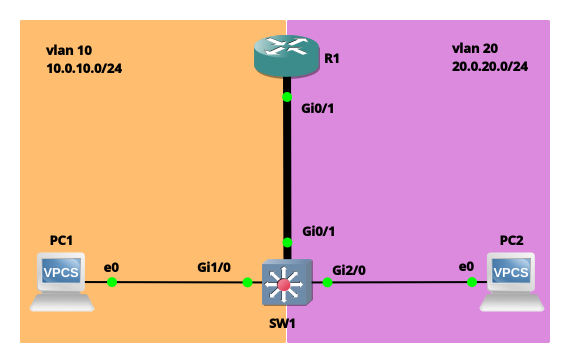
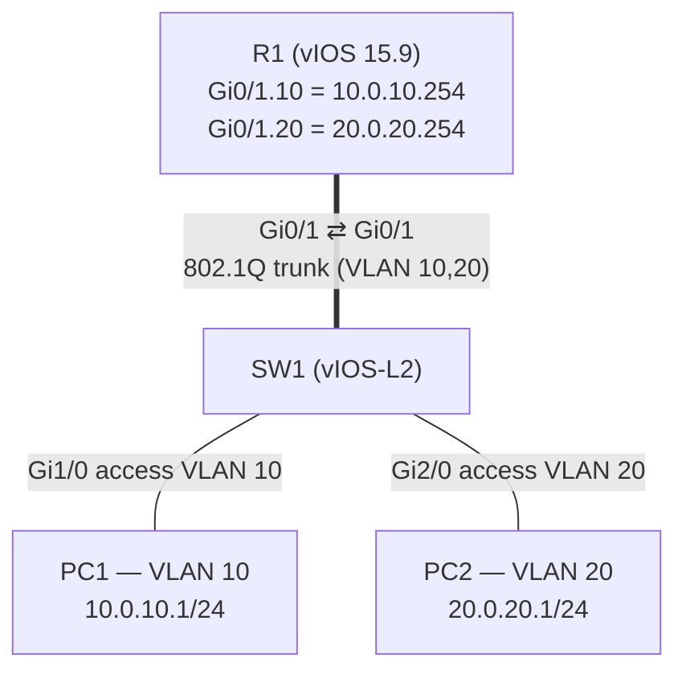

# Lab 01 — Inter-VLAN Routing with Router-on-a-Stick

  

## 📌 Scenario

Two departments sit on the same switch but in different VLANs. VLANs keep their broadcast domains apart — which also means PC1 (VLAN 10) and PC2 (VLAN 20) **cannot talk to each other** without a Layer 3 device.

**Router-on-a-Stick (ROAS)** solves this with a single physical link: the switch sends both VLANs to the router over an **802.1Q trunk**, and the router uses one **sub-interface per VLAN** as each VLAN's default gateway.

**Objectives**
- Create VLANs 10 and 20 and assign access ports
- Build an 802.1Q trunk between SW1 and R1
- Configure dot1Q sub-interfaces on R1 as VLAN gateways
- Verify PC1 ↔ PC2 reachability through the router

---

## 🗺️ Topology





---

## 🔢 Addressing Plan

| Device | Interface | IP / Mask | VLAN | Role |
|--------|-----------|-----------|------|------|
| R1 | Gi0/1.10 | 10.0.10.254/24 | 10 | VLAN 10 default gateway |
| R1 | Gi0/1.20 | 20.0.20.254/24 | 20 | VLAN 20 default gateway |
| SW1 | Gi0/1 | — | 10,20 (trunk) | Uplink to R1 |
| SW1 | Gi1/0 | — | 10 (access) | PC1 |
| SW1 | Gi2/0 | — | 20 (access) | PC2 |
| PC1 | e0 | 10.0.10.1/24 | 10 | GW 10.0.10.254 |
| PC2 | e0 | 20.0.20.1/24 | 20 | GW 20.0.20.254 |

---

## ⚙️ Configuration

Full configs: [`configs/`](./configs/)

### SW1 — VLANs, access ports, trunk
```cisco
vlan 10
vlan 20
!
interface GigabitEthernet1/0
 description vlan10-access
 switchport mode access
 switchport access vlan 10
!
interface GigabitEthernet2/0
 description vlan20-access
 switchport mode access
 switchport access vlan 20
!
interface GigabitEthernet0/1
 description Trunk-UPLINK
 switchport trunk encapsulation dot1q
 switchport mode trunk
 switchport trunk allowed vlan 10,20
```
> VLANs are stored in `vlan.dat`, not in the running-config, which is why `vlan 10` / `vlan 20` don't appear in `configs/SW1.cfg`. Assigning an access port to a VLAN auto-creates it.

### R1 — sub-interfaces
```cisco
interface GigabitEthernet0/1
 no shutdown
!
interface GigabitEthernet0/1.10
 description vlan10-GW
 encapsulation dot1Q 10
 ip address 10.0.10.254 255.255.255.0
!
interface GigabitEthernet0/1.20
 description vlan20-GW
 encapsulation dot1Q 20
 ip address 20.0.20.254 255.255.255.0
```
> The physical interface carries **no IP address** — it only has to be up. Each sub-interface handles one VLAN tag.

### PCs (VPCS)
```
PC1> ip 10.0.10.1 10.0.10.254 24
PC2> ip 20.0.20.1 20.0.20.254 24
```

---

## 🔍 How It Works — PC1 pings PC2

1. PC1 sees 20.0.20.1 is **not** in its own subnet, so it sends the frame to its gateway's MAC (R1 Gi0/1.10).
2. SW1 receives it untagged on Gi1/0 (VLAN 10) and forwards it out the trunk **tagged VLAN 10**.
3. R1 receives the tag-10 frame on Gi0/1.10, strips the tag, and routes the packet — 20.0.20.0/24 is directly connected on Gi0/1.20.
4. R1 rewrites the Layer 2 header (new source MAC = R1, destination MAC = PC2) and sends it back down the **same physical link tagged VLAN 20**.
5. SW1 forwards it out Gi2/0 untagged to PC2. The reply takes the reverse path.

The packet crosses the trunk **twice** — once up, once down. That's the "stick", and it's also ROAS's main limitation: all inter-VLAN traffic shares one link's bandwidth.

---

## ✅ Verification

Command outputs go in [`verification/`](./verification/).

| # | Device | Command | What to look for |
|---|--------|---------|------------------|
| 1 | SW1 | `show vlan brief` | Gi1/0 in VLAN 10, Gi2/0 in VLAN 20 |
| 2 | SW1 | `show interfaces trunk` | Gi0/1 trunking, 802.1q, VLANs 10,20 allowed & forwarding |
| 3 | R1 | `show ip interface brief` | Gi0/1, Gi0/1.10, Gi0/1.20 up/up |
| 4 | R1 | `show vlans` | dot1Q sub-interfaces and their VLAN IDs |
| 5 | R1 | `show ip route connected` | 10.0.10.0/24 and 20.0.20.0/24 as `C` routes |
| 6 | PC1 | `ping 10.0.10.254` | Gateway reachable |
| 7 | PC1 | `ping 20.0.20.1` | Inter-VLAN reachability ✅ |
| 8 | PC1 | `trace 20.0.20.1` | First hop is 10.0.10.254 (traffic goes via R1) |

---

## 🧠 What I Learned

- VLANs separate broadcast domains — different VLANs **need Layer 3** to communicate.
- One physical router port can serve many VLANs using **802.1Q sub-interfaces**.
- The VLAN number in `encapsulation dot1Q <id>` must match the VLAN tag the switch sends — the sub-interface number (`.10`) is just a label, though matching them is good practice.
- On vIOS-L2, `switchport trunk encapsulation dot1q` must be set **before** `switchport mode trunk`.
- ROAS is simple and cheap, but the single trunk is a bottleneck and single point of failure — which is why the next lab uses SVIs on a Layer 3 switch.

---

## 📝 Notes

- `20.0.20.0/24` is public IP space. That's fine in an isolated lab, but real networks should use private ranges (RFC 1918: 10/8, 172.16/12, 192.168/16). Future labs will use private addressing.

---

## 🔁 Rebuild This Lab

1. GNS3 with **vIOS 15.9** (router) and **vIOS-L2** (switch) on QEMU, plus two VPCS.
2. Open `gns3/ROAS.gns3` (your image names must match) or build the topology from the diagram.
3. Paste `configs/R1.cfg` and `configs/SW1.cfg` into the consoles; load `PC1.vpc` / `PC2.vpc` into VPCS.
4. Run the verification commands.
