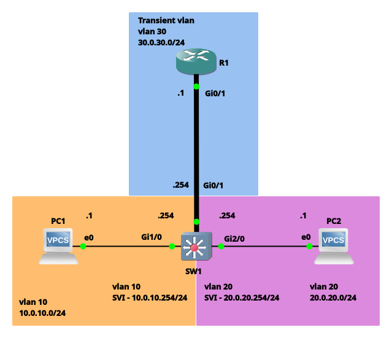
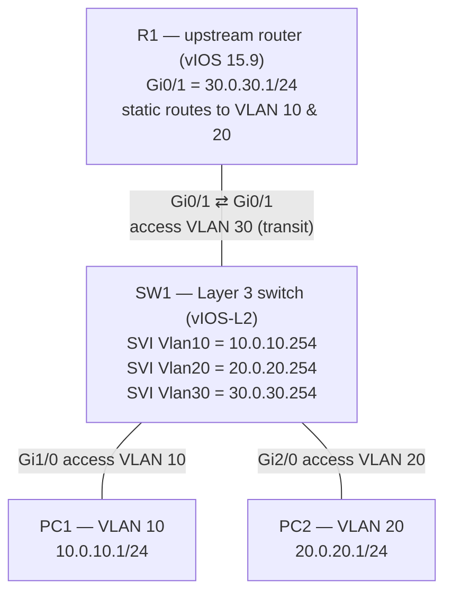

# Lab 02 — Inter-VLAN Routing with SVIs on a Layer 3 Switch

  

⬅️ Previous: [Lab 01 — Router-on-a-Stick](../01-router-on-a-stick/)

## 📌 Scenario

[Lab 01](../01-router-on-a-stick/) routed between VLANs on an external router, so every inter-VLAN packet crossed the trunk twice. This lab moves the routing **inside the switch** using **Switched Virtual Interfaces (SVIs)** — one virtual Layer 3 interface per VLAN.

The router stays in the topology, but in a new role: an **upstream router** reached over a dedicated **transit VLAN (VLAN 30)**, the way a campus core connects to a WAN or Internet edge router.

**Objectives**
- Create SVIs for VLANs 10 and 20 as the PCs' default gateways
- Route between VLANs on the switch itself
- Connect the switch to an upstream router through a transit VLAN
- Give the router static routes back to the user VLANs
- Investigate how `ip routing` behaves on vIOS-L2

---

## 🗺️ Topology





---

## 🔢 Addressing Plan

| Device | Interface | IP / Mask | VLAN | Role |
|--------|-----------|-----------|------|------|
| SW1 | Vlan10 (SVI) | 10.0.10.254/24 | 10 | PC1 default gateway |
| SW1 | Vlan20 (SVI) | 20.0.20.254/24 | 20 | PC2 default gateway |
| SW1 | Vlan30 (SVI) | 30.0.30.254/24 | 30 | Transit link to R1 |
| SW1 | Gi0/1 | — | 30 (access) | To R1 |
| SW1 | Gi1/0 | — | 10 (access) | PC1 |
| SW1 | Gi2/0 | — | 20 (access) | PC2 |
| R1 | Gi0/1 | 30.0.30.1/24 | — | Upstream router |
| PC1 | e0 | 10.0.10.1/24 | 10 | GW 10.0.10.254 |
| PC2 | e0 | 20.0.20.1/24 | 20 | GW 20.0.20.254 |

---

## ⚙️ Configuration

Full configs: [`configs/`](./configs/)

### SW1 — SVIs and access ports
```cisco
ip routing
!
interface Vlan10
 description SVI-10
 ip address 10.0.10.254 255.255.255.0
!
interface Vlan20
 description SVI-20
 ip address 20.0.20.254 255.255.255.0
!
interface Vlan30
 description SVI-30
 ip address 30.0.30.254 255.255.255.0
!
interface GigabitEthernet0/1
 description vlan30-access
 switchport mode access
 switchport access vlan 30
!
interface GigabitEthernet1/0
 description vlan10-access
 switchport mode access
 switchport access vlan 10
!
interface GigabitEthernet2/0
 description vlan20-access
 switchport mode access
 switchport access vlan 20
```
> `ip routing` is shown here for clarity. It does **not** appear in `configs/SW1.cfg` — see [the vIOS-L2 finding](#-finding-ip-routing-is-on-by-default-on-vios-l2) below.

### R1 — uplink and return routes
```cisco
interface GigabitEthernet0/1
 description To-SW1
 ip address 30.0.30.1 255.255.255.0
!
ip route 10.0.10.0 255.255.255.0 30.0.30.254
ip route 20.0.20.0 255.255.255.0 30.0.30.254
```
> SW1 knows VLANs 10, 20 and 30 as directly connected. R1 only knows 30.0.30.0/24, so it needs static routes pointing back to SW1's VLAN 30 SVI to reply to the PCs.

---

## 🔍 How It Works

**PC1 → PC2 (inter-VLAN, stays inside SW1)**
1. PC1 sends the packet to its gateway's MAC — the Vlan10 SVI.
2. SW1 routes internally from Vlan10 to Vlan20 (both directly connected), rewrites the Layer 2 header and sends it out Gi2/0.
3. **No trunk, no 802.1Q tags, and the R1 link carries nothing.** The router is not involved at all.

**PC1 → R1 (leaving the campus)**
1. SW1 routes from Vlan10 to Vlan30 and forwards to R1 at 30.0.30.1.
2. R1 replies to 10.0.10.1 using its static route via 30.0.30.254.

### ROAS vs SVI

| | Lab 01 — Router-on-a-Stick | Lab 02 — SVI |
|---|---|---|
| Where routing happens | External router | Inside the switch |
| Link to router | 802.1Q trunk (VLANs 10, 20) | Access port (VLAN 30 only) |
| Inter-VLAN path | Crosses the trunk **twice** | Never leaves the switch |
| Bottleneck | One physical link | Switch backplane / hardware forwarding |
| Gateway interfaces | Router sub-interfaces (`Gi0/1.10`) | Switch SVIs (`Vlan10`) |
| Typical use | Small sites, no L3 switch | Campus distribution / core |

---

## 🧪 Finding: `ip routing` is ON by default on vIOS-L2

Inter-VLAN routing worked **before** I typed `ip routing`, and the command never appeared in `show running-config`. I tested it:

```text
SW1# show running-config | include ip routing
SW1#                                              ← nothing shown

SW1# show running-config all | include ip routing
ip routing protocol purge interface
ip routing                                        ← present as a hidden default

SW1(config)# no ip routing
PC1> ping 20.0.20.1                               ← fails: no inter-VLAN routing

SW1(config)# ip routing
PC1> ping 20.0.20.1                               ← works again
```

**Why:** IOS only shows commands in `show running-config` when they differ from the default.
- On **physical Catalyst switches** (2960-X/3560/3650 etc.) routing is **off** by default — `ip routing` must be typed and then appears in the config. Forgetting it is a classic inter-VLAN fault: SVIs are up/up, PCs ping their gateway, but nothing routes.
- **vIOS-L2** is built from router IOS code, where routing is **on** by default — so it's hidden.

`show running-config all` is the way to see default commands that are normally hidden.

**Side effect observed:** after toggling `no ip routing` → `ip routing`, the first pings timed out. Disabling routing clears the routing table and ARP entries; everything had to be relearned before traffic flowed again.

---

## ✅ Verification

| # | Device | Command | What to look for |
|---|--------|---------|------------------|
| 1 | SW1 | `show ip interface brief` | Vlan10, Vlan20, Vlan30 up/up |
| 2 | SW1 | `show ip route` | `C` routes for 10.0.10.0/24, 20.0.20.0/24, 30.0.30.0/24 |
| 3 | SW1 | `show vlan brief` | Gi1/0 → VLAN 10, Gi2/0 → VLAN 20, Gi0/1 → VLAN 30 |
| 4 | R1 | `show ip route static` | Two `S` routes via 30.0.30.254 |
| 5 | PC1 | `ping 20.0.20.1` | Inter-VLAN reachability ✅ |
| 6 | PC1 | `trace 20.0.20.1` | Single hop: 10.0.10.254 |
| 7 | PC1 | `ping 30.0.30.1` | Replies with **TTL 254** |

**Why TTL 254 from R1?** Cisco IOS starts packets at TTL 255 (VPCS starts at 64). The reply crosses one routing hop — SW1 — so it arrives at 254. That single decrement is proof the switch is routing.

Command outputs go in [`verification/`](./verification/).

---

## 🧠 What I Learned

- An **SVI** is a virtual Layer 3 interface for a whole VLAN; it replaces router sub-interfaces as the gateway.
- With SVIs, inter-VLAN traffic **never leaves the switch** — no trunk needed to a router.
- An upstream router needs **return routes** to the user VLANs, or replies have nowhere to go.
- `ip routing` defaults differ by platform: **on** in vIOS-L2, **off** on physical Catalyst switches. `show running-config all` reveals hidden defaults.
- TTL tells you how many routers a packet crossed — and the starting value tells you what sent it (IOS 255, VPCS 64).

---

## 📝 Notes

- `20.0.20.0/24` and `30.0.30.0/24` are public IP space, used here only in an isolated lab. Future labs use RFC 1918 private ranges.
- Packet captures for this lab will be added later.

---

## 🔁 Rebuild This Lab

1. GNS3 with **vIOS 15.9** (router) and **vIOS-L2** (switch) on QEMU, plus two VPCS.
2. Open `gns3/ROAS-SVI.gns3` or build the topology from the diagram.
3. Paste `configs/R1.cfg` and `configs/SW1.cfg` into the consoles. On a physical Catalyst switch, add `ip routing`.
4. Load `PC1.vpc` / `PC2.vpc` into VPCS and run the verification commands.
