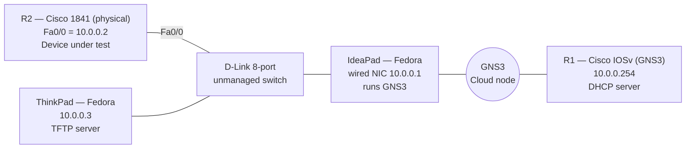
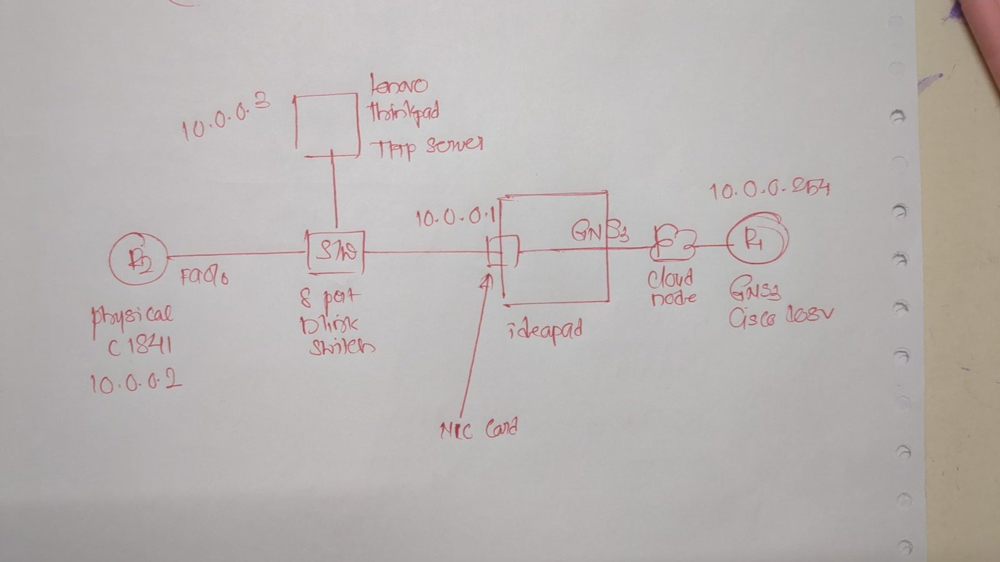

# P01 — Cisco Boot Process & Config Register (Physical Lab)

  

Hands-on with **real hardware**: how a Cisco router boots, what the configuration register controls, how to recover a router with no password or no IOS, and how a blank router can configure itself over the network (AutoInstall).

The device under test is a physical **Cisco 1841**. DHCP is served by an **IOSv router running in GNS3**, bridged onto the physical LAN — a hybrid physical + virtual lab.

> 🚧 **Work in progress** — documented step by step as I run it on the gear. Completed steps are marked ✅.

---

## 📋 Lab Plan

Steps are run in dependency order: safe console-only labs first, backups before anything risky, network provisioning last.

### Part 1 — Boot & Recovery
| Step | Topic | Status |
|------|-------|--------|
| 1 | [Topology bring-up](#step-1--topology-bring-up) | ✅ Done |
| 2 | [Baseline backup — config + IOS image](#step-2--baseline-backup) | ✅ Done |
| 3 | Config register basics (0x2102 / 0x2002 / ROMMON) | 🔜 Next |
| 4 | Password recovery (0x2142) | 📋 Planned |
| 5 | `boot system` order (TFTP → flash fallback) | 📋 Planned |
| 6 | ROMMON image recovery (`tftpdnld`) | 📋 Planned |

### Part 2 — Zero-Touch Provisioning
| Step | Topic | Status |
|------|-------|--------|
| 7 | AutoInstall via DHCP option 67 | 📋 Planned |
| 8 | AutoInstall via `network-confg` | 📋 Planned |
| 9 | `boot network`, `service config`, `configure replace` | 📋 Planned |
| 10 | AutoInstall over serial (SLARP) | 📋 Planned |

---

## 🗺️ Topology



<details>
<summary>📝 Original hand-drawn sketch</summary>


</details>

| Device | Type | IP | Role |
|--------|------|----|------|
| R2 | Cisco 1841 (physical) | 10.0.0.2 | Device under test |
| R1 | Cisco IOSv in GNS3 | 10.0.0.254 | DHCP server (options 150 / 67) — used from Step 7 |
| ThinkPad | Fedora Linux | 10.0.0.3 | TFTP server — configs and IOS image |
| IdeaPad | Fedora Linux | 10.0.0.1 | GNS3 host; its wired NIC bridges R1 onto the LAN |
| D-Link switch | Unmanaged, 8-port | — | Flat L2 segment, no STP |

**Why this design**
- **Hybrid:** a virtual IOSv router serves DHCP to a physical router through a GNS3 **Cloud node** bound to the laptop's wired NIC. (Wi-Fi bridging doesn't work for this — access points drop frames from unassociated MACs.)
- **Unmanaged switch = no STP**, so the 1841's DHCP isn't delayed by 30 s of listening/learning.
- **One broadcast domain**, so broadcast TFTP requests used by AutoInstall reach the server directly.

---

## Step 1 — Topology bring-up

Before touching the 1841, prove every path works:

| Test | From | Result |
|------|------|--------|
| `ping 10.0.0.254` (R1 via Cloud node) | IdeaPad | ✅ |
| `ping 10.0.0.3` (TFTP server) | IdeaPad | ✅ |
| TFTP download (`get`) | IdeaPad → ThinkPad | ✅ |
| TFTP upload (`put`) | IdeaPad → ThinkPad | ✅ |

**Fedora TFTP server setup (ThinkPad)**
```bash
sudo dnf install tftp-server tftp
sudo systemctl enable --now tftp.socket
sudo firewall-cmd --add-service=tftp --permanent && sudo firewall-cmd --reload
# files served from /var/lib/tftpboot
```
Fedora's TFTP server is read-only by default. Router uploads (`copy ... tftp:`) also need write access: the `-c` (create) option, a writable folder, and the SELinux boolean `tftp_anon_write`.

---

## Step 2 — Baseline backup

Record the router's state and back up **both its config and its IOS image** before any experiment — Steps 5 and 6 depend on that image copy.

### Router facts (`show version`)

| Item | Value |
|------|-------|
| IOS | 12.4(10c), `C1841-ADVSECURITYK9-M` |
| ROM bootstrap | 12.4(13r)T |
| Image file | `flash:c1841-image` — 20,967,448 bytes |
| RAM | 128 MB (115712K + 15360K) |
| Flash | 64 MB CompactFlash |
| NVRAM | 191 KB |
| Config register | **0x2102** (normal boot) |

### Give Fa0/0 a lab IP and test reachability
```cisco
interface FastEthernet0/0
 ip address 10.0.0.2 255.255.255.0
 no shutdown
```
```text
Router#ping 10.0.0.254
!!!!!
Success rate is 100 percent (5/5)
Router#ping 10.0.0.3
.!!!!
Success rate is 80 percent (4/5)
```

### Back up the config and image
```cisco
copy running-config tftp://10.0.0.3/r2-baseline-config
copy startup-config tftp://10.0.0.3/r2-baseline-startup-config
copy flash:c1841-image tftp://10.0.0.3/c1841-image
verify /md5 flash:c1841-image                    ! hash of the original
verify /md5 tftp://10.0.0.3/c1841-image          ! hash of the server copy, read back
```

### ✅ Image backup verified

Checked three independent ways — all three hashes are identical:

| # | What was hashed | Computed by | Size | MD5 |
|---|-----------------|-------------|------|-----|
| 1 | Original in flash | Router — `verify /md5 flash:` | 20,967,448 bytes | `1670ad91fc39f7da598ffbd37f72760d` |
| 2 | Copy on the TFTP server | ThinkPad — `md5sum` | — | `1670ad91fc39f7da598ffbd37f72760d` |
| 3 | Copy on the TFTP server, read back over the network | Router — `verify /md5 tftp:` | 20,967,448 bytes | `1670ad91fc39f7da598ffbd37f72760d` |

```text
Router#copy flash:c1841-image tftp:
Address or name of remote host []? 10.0.0.3
Destination filename [c1841-image]?
!!!!!!!!!!!!!!!!!!!!!!!!!!!!!!!!!!!!!!!!!!!!!!!!!!!!!!!!!!!!!!!!!!!!
20967448 bytes copied in 68.404 secs (306524 bytes/sec)

Router#verify /md5 flash:c1841-image
.....Done!
verify /md5 (flash:c1841-image) = 1670ad91fc39f7da598ffbd37f72760d

Router#verify /md5 tftp://10.0.0.3/c1841-image
Loading c1841-image from 10.0.0.3 (via FastEthernet0/0): !!!!!!!!!!
[OK - 20967448 bytes]
verify /md5 (tftp://10.0.0.3/c1841-image) = 1670ad91fc39f7da598ffbd37f72760d
```
```text
$ md5sum /var/lib/tftpboot/c1841-image
1670ad91fc39f7da598ffbd37f72760d  c1841-image
```
Identical hashes = a bit-for-bit copy. Check 3 is the strongest: it proves the file can be **read back from the server over TFTP** intact, which is exactly what `boot system tftp` and ROMMON `tftpdnld` will do in Steps 5 and 6.

**Backups held on the TFTP server**
- ✅ IOS image `c1841-image` — size and MD5 verified
- ✅ Running-config (676 bytes) — [`configs/R2-1841-lab-baseline.cfg`](./configs/R2-1841-lab-baseline.cfg). It was saved to NVRAM with `write memory` first, so startup-config holds the same content.
- ✅ Factory-state config recorded before any change — [`configs/R2-1841-factory-baseline.cfg`](./configs/R2-1841-factory-baseline.cfg)

Console logs: [`console-logs/`](./console-logs/) · Server-side checks: [`verification/`](./verification/)

### 🔍 Details noticed in this step
- **First ping `.!!!!`** — the first echo is lost while the router ARPs for 10.0.0.3. Normal, not a fault.
- **Flash file dated `Feb 23 1907`** — the router's clock has never been set, so file timestamps are meaningless. A practical reason NTP matters.
- **Image is ~20 MB**, safely under the 32 MB size where some TFTP client/server combinations fail (16-bit block counter × 512-byte blocks).
- **A backup isn't a backup until it's verified.** While the copy was running, `ls -l` on the server showed partial sizes (3.9 MB, 17.8 MB) — easy to mistake for a finished file. Only the router's `bytes copied` line plus matching MD5 on both ends proves the copy is complete.
- **TFTP is slow by design: 306 KB/s (~2.5 Mbps) on a 100 Mbps link.** TFTP sends one 512-byte block, then waits for an ACK before the next. 20.9 MB = ~40,950 blocks in 68 s ≈ 1.7 ms per block round trip. The link isn't the limit; the stop-and-wait protocol is.
- **`verify /md5` works on remote files too** — `verify /md5 tftp://10.0.0.3/c1841-image` downloads the whole file through the router (`[OK - 20967448 bytes]`), hashes it on the fly and discards it. Nothing is written to flash. It also accepts `ftp:`, `scp:` and `http:`.
- **Fedora TFTP uploads:** in practice the target file often has to exist and be writable before the router can upload to it.

---

## 🧰 Tools

| Tool | Use |
|------|-----|
| Tabby | Console access + session logging |
| GNS3 + IOSv | Virtual DHCP server bridged to the physical LAN |
| Fedora `tftp-server` | TFTP for configs and IOS image |
| Wireshark | DHCP/TFTP captures (Part 2) |

> The Cisco IOS image is licensed software and is **not** included in this repository. The router's serial number is redacted from logs.
